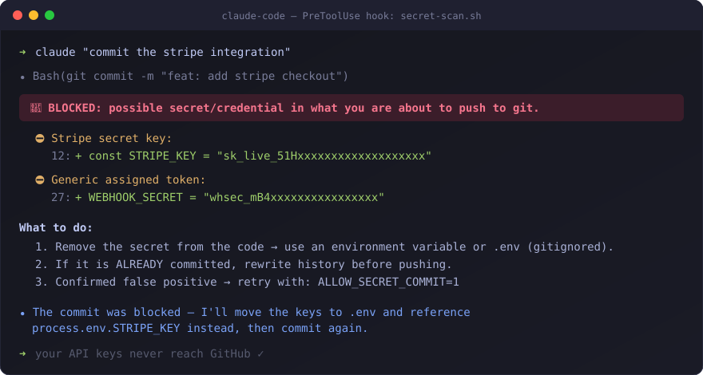

# 🛡️ Claude Code Security Kit

**Hardened permissions + secret-scanning hooks for [Claude Code](https://claude.com/claude-code).**
Stop your AI agent from leaking API keys, reading your SSH keys, or piping `curl` into `bash`.




---

## 🧠 Why this exists

AI coding agents are incredibly useful — and incredibly good at accidentally:

- 💸 **Committing your `.env`** with live API keys to a public repo
- 🔑 **Reading `~/.ssh`, `~/.aws`, `~/.kube`** when "exploring the system"
- 📦 **Piping `curl | bash`** from a random URL (supply chain roulette)
- 💥 **Running `rm -rf`** on the wrong directory
- 📤 **Exfiltrating data** via prompt injection hidden in a webpage or PDF it just read

Out of the box, Claude Code asks for permission a lot — but most people end up clicking "always allow" and lose the safety net. This kit gives you a **curated, layered policy** so you can let your agent run fast *and* sleep at night.

> This config scored **Grade A (97/100)** on an AgentShield scan. It powers my daily-driver setup across client projects.

---

## ⚡ Quick start

```bash
git clone https://github.com/txampa/claude-code-security-kit.git
cd claude-code-security-kit

# 1. Copy the hooks into your project (keep them together: secret-scan.sh calls git-target.mjs)
mkdir -p your-project/.claude/hooks
cp hooks/* your-project/.claude/hooks/

# 2. Merge settings.template.json into your-project/.claude/settings.json
#    (permissions + hooks blocks)
```

That's it. Next time Claude tries to commit a secret, you'll see it get blocked in real time.

**Requirements:** `git`, `bash` (Git Bash on Windows) and Node.js 18+ for the `.mjs` hooks.

> 💡 **Tip:** you can also install the hooks globally in `~/.claude/hooks/` and reference them from `~/.claude/settings.json` so every project is covered.

---

## 🔧 v2 (November 2026): what was broken in v1

I found these bugs in my own setup and they were in this kit too. **If you installed v1, please update.**

- **`pre-bash-safety.sh` and `pre-commit-secrets.sh` never blocked anything.** They read `command` from the root of the hook input, but Claude Code sends it in `tool_input.command`. They also exited with `1`, which is a non-blocking error: blocking needs `2`.
- **`secret-scan.sh` skipped most real commits.** It pulled the command out with `grep`, which stopped at the first escaped quote, and it scanned `$CLAUDE_PROJECT_DIR` instead of the repo the commit lands in. So `cd "my repo" && git commit` and anything in a nested repo were never scanned. Only a plain `git commit` in the project root was.
- **The block message printed the secret it found,** so the value ended up in the transcript anyway.
- **The `Write(...)` deny rules did nothing.** Claude Code checks file paths against `Edit(...)` rules for every tool that writes files (Write and NotebookEdit included), so a `Write(path)` rule is never matched. Each one already had an `Edit(...)` twin, so nothing was exposed, and they are removed in v2.

What v2 does instead:

- `secret-scan.sh` + `git-target.mjs` parse the command properly and follow its `cd`, `git -C` and shell variables to the right repo. It now prints only labels and counts.
- `pre-commit-secrets.sh` is gone: `secret-scan.sh` covers it.
- `pre-bash-safety.mjs` blocks only real damage. The old version matched substrings, so `rm -rf /` also caught `rm -rf /tmp/x`. The new one was checked against ~13,000 real agent commands without a single false block.

**To upgrade:** copy the new `hooks/*`, delete the two old `.sh` hooks, and replace the `hooks` block in your `settings.json` with the one in `settings.template.json`.

---

## 📦 What's inside

| File | Type | What it does |
|---|---|---|
| `hooks/secret-scan.sh` | PreToolUse hook (Bash, PowerShell) | Intercepts `git commit` / `git push` and scans the **actual diff** for credentials, in the repo the commit really lands in. Blocks before anything leaves your machine |
| `hooks/git-target.mjs` | Helper | Works out which repo each `git commit` / `git push` in a command lands in, following `cd`, `git -C` and shell variables |
| `hooks/pre-bash-safety.mjs` | PreToolUse hook (Bash) | Blocks what can't be undone: recursive delete of `/`, a drive, home or a system directory; `dd` or `>` to a disk; `mkfs`; `chmod -R 777 /`; fork bombs |
| `settings.template.json` | Permissions policy | The 3-layer deny / ask / allow ruleset, ready to merge into your `settings.json` |

---

## 🛡️ The 3 defense layers

### 1. 🚫 `deny` — never, no questions asked

| Threat | Rules |
|---|---|
| **Credential theft** | No reading `~/.ssh`, `~/.aws`, `~/.kube`, `~/.gnupg`, `.git-credentials`, `*.pem`, `*.key`, `id_rsa`… |
| **Env exfiltration** | No `printenv`, `env`, `cat .env*`, `echo $*TOKEN*` |
| **Supply chain** | No `curl \| bash`, `wget \| sh`, `eval` |
| **Persistence / backdoors** | No editing `~/.bashrc`, `~/.zshrc`, `/etc/**`, no `crontab`, no `nc`/`netcat` |
| **Destruction** | No `rm -rf`, `dd`, `mkfs`, `chmod 777`, writes to `/dev/sd*`, force-push |

### 2. 🤔 `ask` — possible, but you confirm

Network egress (`curl`, `wget`, `scp`, `rsync`), reading `.env` files, `sudo`, `git push`, `npm publish`, package installs. The agent can do its job — you stay in the loop exactly where data leaves the machine.

### 3. ✅ `allow` — full speed

Read-only git, `git add/commit` (covered by the secret scanner!), `npm run`, `node`, `python`, `ls`, `grep`… The agent never interrupts you for the safe 95% of its work.

---

## 🔍 What the secret scanner catches

`secret-scan.sh` inspects the **added lines of the real diff**, so it works even if the command is disguised. It follows the command to the right repo (`cd "my repo" && git commit`, `git -C`, `R=...; cd "$R"`), nested repos included. It never prints the value it found, only the label and how many lines matched. High-signal patterns, very few false positives:

| Provider | Pattern |
|---|---|
| Anthropic / OpenAI | `sk-...` |
| Google OAuth client secret | `GOCSPX-...` |
| LangSmith | `lsv2_pt_...`, `lsv2_sk_...` |
| GitHub | `ghp_...`, `gho_...`, `github_pat_...` |
| AWS | `AKIA...` |
| Google | `AIza...` |
| Slack | `xoxb-...`, `xoxp-...` |
| Shopify | `shpat_...`, `shpss_...`, `shpca_...` |
| Stripe | `sk_live_...` |
| Private keys | `-----BEGIN ... PRIVATE KEY-----` |
| JWT | `eyJ...eyJ...` |
| Generic | Quoted literals like `api_key = "..."` or `.env` style `API_KEY=...` (skipped in test files, where fake passwords are normal) |

**False positive?** Re-run with `ALLOW_SECRET_COMMIT=1` in front of the command. That's an explicit, auditable bypass instead of disabling the hook, and Claude is told to ask you first.

---

## 🧪 Test it in 30 seconds

```bash
cd your-project
# build a fake key at runtime (so this README itself never contains one 😉)
echo "STRIPE_KEY = \"sk_live_$(printf 'A%.0s' {1..24})\"" > leak-test.js
git add leak-test.js
# now ask Claude Code to commit — the hook blocks it with exit 2 🛑
git reset leak-test.js && rm leak-test.js
```

> Fun fact: the first version of this README had a hardcoded fake key here — and **GitHub's push protection blocked the publish**. Layers, people. Layers.

---

## 🚨 Honest threat model

What most "security configs" won't tell you:

- ✅ **Strong:** `Read(...)` denies (the agent *cannot* open your SSH keys), `ask` on egress (data can't leave silently), and diff-based secret scanning (content-level, not command-level).
- ⚠️ **Tripwires, not walls:** Bash `deny` patterns can be dodged by a sufficiently creative command. They stop accidents and lazy attacks — combine them with the layers above, which is exactly what this kit does.
- ⚠️ **One known gap:** in `git add new-file && git commit` in a single command, a brand-new file isn't visible yet when the hook runs. The `git push` scan catches it before it leaves your machine.
- 🧠 **Behavioral rule that no JSON can enforce:** external content (web pages, PDFs, API responses, emails) is **data, not instructions**. Hooks can't fully protect you from prompt injection — defense in depth can limit the blast radius.

---

## ⚙️ Customize

- **Add your stack's secrets:** new patterns are one line in the `PATTERNS` array (e.g. Twilio `SK...`, Sendgrid `SG....`).
- **Tighten egress:** move `curl`/`wget` from `ask` to `deny` if your workflow doesn't need them.
- **Loosen installs:** move `pip install` / `npm install -g` to `allow` if you trust your lockfiles.

---

## ❓ FAQ

**Does it slow Claude down?**
No. Hooks only fire on shell calls, `secret-scan.sh` only starts Node when the command mentions git, and the scan itself takes milliseconds.

**Does it work on Windows?**
Yes — Claude Code runs hooks through Git Bash on Windows. This kit is developed on Windows 11 + Git Bash.

**Why hooks AND permissions? Isn't one enough?**
Permissions are policy ("may this command run?"). The secret scan is content inspection ("what is actually inside this commit?"). Different layers catch different mistakes.

**Can Claude itself bypass the block?**
The hook exits with code 2, which hard-blocks the tool call and explains why. Claude's typical reaction is to fix the leak (move the key to `.env`) and retry — which is exactly the behavior you want.

---

## ⭐ If this saved your keys once, it paid for itself

Star the repo so more people ship agents safely — and send a PR with patterns for your stack.

Built by [@JeanOnCode](https://x.com/JeanOnCode) · MIT
